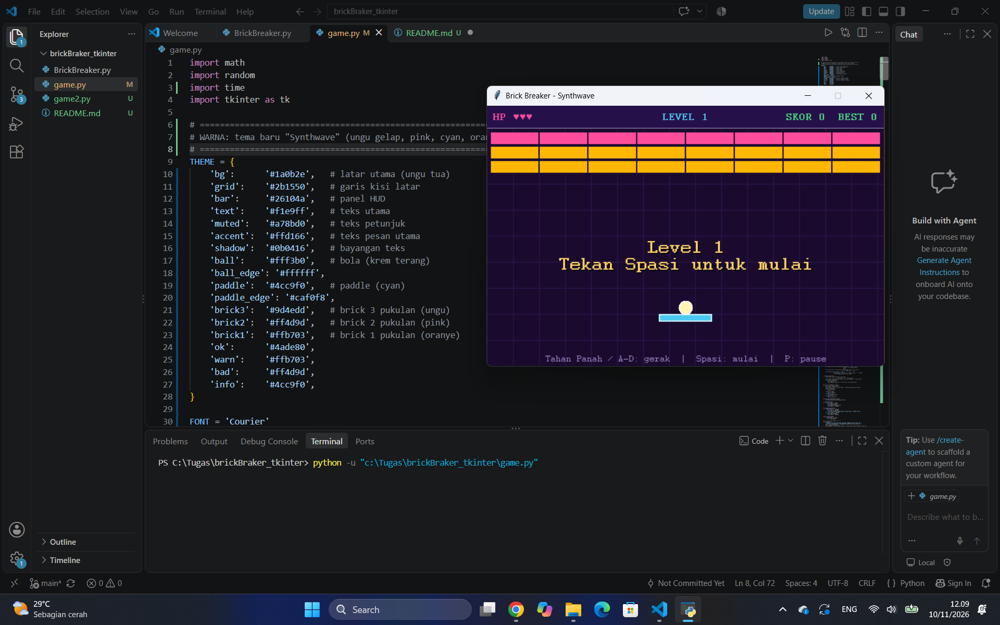

penjelasan:
1. mengubah tema baru "Synthwave" (ungu gelap, pink, cyan, oranye)
2. mengubah kecepatan agar permainan tidak lemot
3. Skor dan level. Ada skor, skor tertinggi, dan level. Kalau semua brick habis, game lanjut ke level berikutnya, tidak langsung selesai
4. Nyawa diperbaiki. Dulu pemain sebenarnya punya 4 kesempatan. Sekarang tepat 3
5. Pantulan lebih Bola memantul sesuai bagian paddle yang kena, jadi bisa diarahkan
6. Ada pause dan restart. Tekan P untuk jeda, R untuk main lagi setelah Game Over
7. Gerak lebih halus. Gerakan dihitung dari waktu asli, dan paddle bergerak selama tombol ditahan, jadi tidak patah-patah
